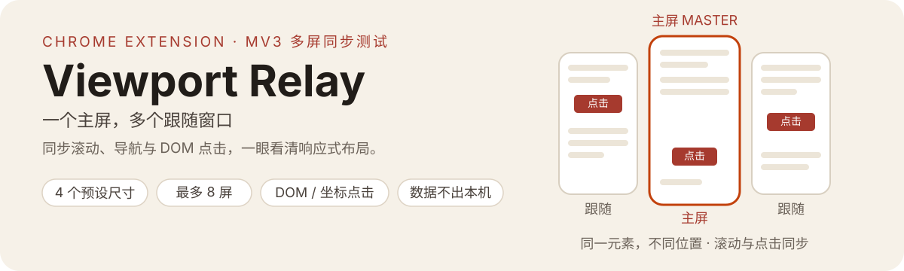
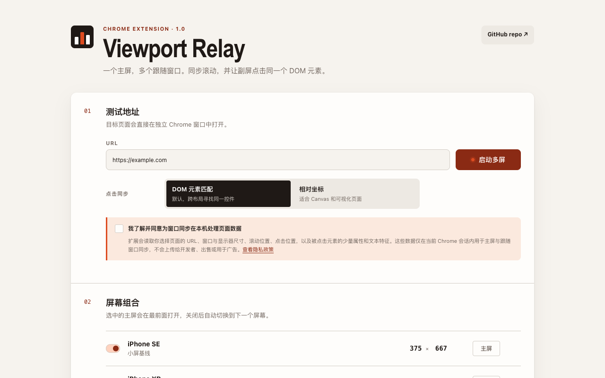
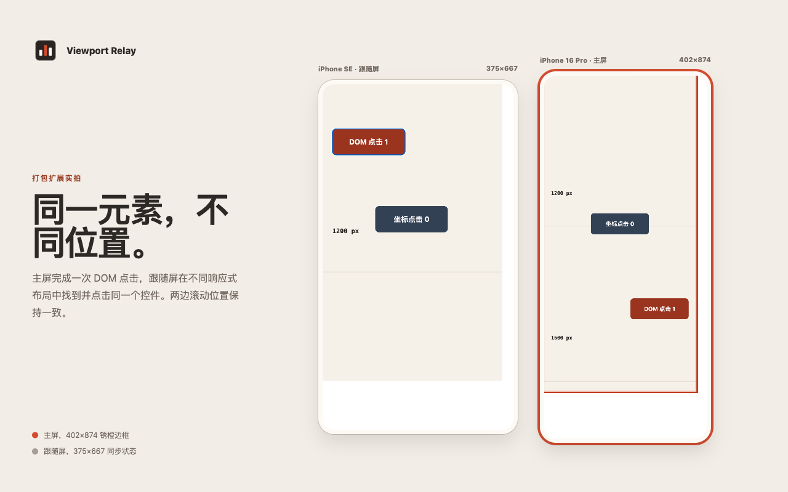

<p align="right"><a href="README.md">中文</a></p>

<p align="center">
  
</p>

<p align="center">
  <a href="https://xiaosang.cc/multi-screen-view/">▶ Try the Launcher</a>
  ·
  <a href="https://github.com/holynova/multi-screen-view">GitHub Repository</a>
</p>

Viewport Relay is a Chrome extension (Manifest V3) for multi-viewport testing: enter a URL, pick a set of screen sizes, and it opens the page in separate Chrome windows arranged side by side. One window acts as the master; the rest follow it — scrolling, navigation, and clicks stay in sync, so you can compare the same page across mobile viewports at a glance. Pure JavaScript, zero dependencies.

## Screenshots

<p align="center">
  
  
</p>

## What Syncs

- **Scrolling**: when the master scrolls, follower windows scroll to the matching position.
- **Navigation**: when the master jumps to a new page, followers open the same URL.
- **Clicks**: by default, clicks match by DOM element features — the same control is found and clicked across different layouts; a relative-coordinate mode is available for Canvas and visualization pages.
- **Session controls**: focus master, reload all, pause/resume sync, rearrange, close all; if the master closes, the next window takes over automatically.

## Screens

4 preset sizes, up to 8 windows at once:

| Size | Resolution | Notes |
|---|---|---|
| iPhone SE | 375 × 667 | Small-screen baseline |
| iPhone XR | 414 × 896 | Older wide-screen model |
| iPhone 16 Pro | 402 × 874 | Default master |
| iPhone 16 Pro Max | 440 × 956 | Large-screen baseline |

You can also add custom sizes (width 240–1000 px, height 320–2000 px, max 8), saved in the current browser for next time.

## Privacy

- Sync data (URL, window and display sizes, scroll and click positions, small target descriptors) stays inside the current Chrome session — never uploaded to the developer, sold, or used for ads.
- Before the first session starts, the launcher shows a data-processing notice that you must actively consent to.
- The extension never reads or syncs form input; there is no account system and no remote code.

## Install

Not yet on the Chrome Web Store (listing copy and assets are ready in `store-listing/` and `store-assets/`). For now, load the unpacked extension:

1. Download or clone this repository.
2. Open `chrome://extensions` and turn on 「开发者模式」 ("Developer mode") in the top-right corner.
3. Click 「加载已解压的扩展程序」 ("Load unpacked") and select the repository directory.
4. Click the Viewport Relay icon in the toolbar to open the launcher.

Or build the zip with `npm run package:extension` (`dist/viewport-relay-1.0.0.zip`) and install that.

## Usage

1. Open the launcher (extension icon, or the [online launcher](https://xiaosang.cc/multi-screen-view/)).
2. Enter the URL to test and pick a click-sync mode (DOM element matching / relative coordinates).
3. Consent to the data-processing notice, pick a screen set, and designate the master.
4. Click 「启动多屏」 ("Launch Multi-Screen"), then scroll, click or navigate in the master — followers sync automatically.

Note: the launcher itself is a static page; real multi-screen sync requires the extension to be installed. Without the extension, submitting the form redirects to this repository.

## Run Locally & Test

The launcher is a plain static page:

```bash
npm run serve   # python3 -m http.server 8765, open http://127.0.0.1:8765
```

Tests (syntax checks + Node tests + store-asset validation):

```bash
npm test
```

## Tech

- Manifest V3: a service worker (`background.js`) manages sessions and window arrangement; content scripts (`targeting.js` + `content.js`) report scrolling and clicks.
- Two click-sync modes: DOM element feature matching (default) and relative coordinates.
- Window layout is computed from the current display's work area (`layout.js`); custom size validation lives in `devices.js`.
- Zero dependencies, pure JS + HTML + CSS.

```
index.html          Launcher: test URL / click mode / screen set / run status
launcher.js         Launcher logic: preset sizes, custom sizes, session controls
background.js       Service worker: sessions, window arrangement, scroll/click/navigation sync
content.js          Content script: reports scrolls and clicks, performs follower actions
targeting.js        Click target descriptors: DOM element feature extraction
devices.js          Size validation: preset and custom size range checks
layout.js           Window layout: arranges windows across the display work area
manifest.json       MV3 manifest: storage / system.display / windows permissions
privacy.html        Privacy policy
store-assets/       Store screenshots, promo images and icon sources
store-listing/      Chinese and English listing copy and submission checklist
test/               Node tests: devices / layout / targeting
```

## License

MIT, see `LICENSE`.
