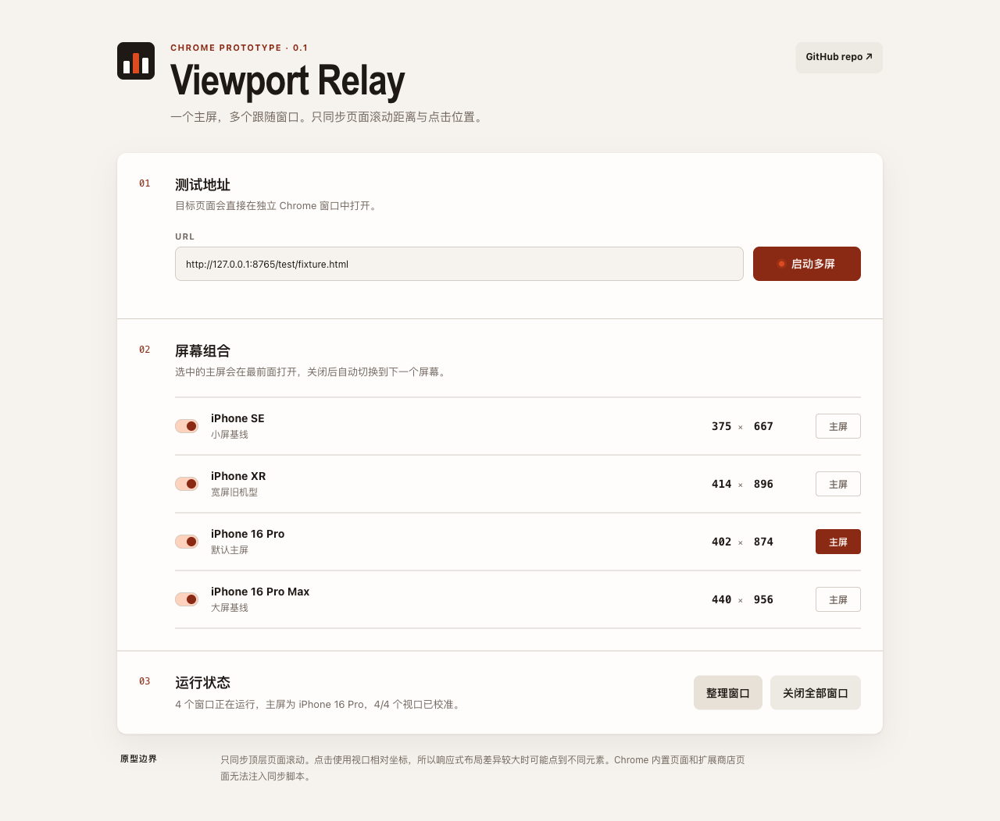

# Viewport Relay / 多屏视口同步

多尺寸网页同步测试扩展。用一个主窗口控制多个跟随窗口，同步导航、滚动与点击，快速比较不同移动端视口下的响应式布局。

A multi-viewport web testing extension. One master window controls multiple followers with synchronized navigation, scrolling, and clicks, for quick responsive-layout comparison across mobile viewports.

密码、文件选择、隐藏字段和一次性验证码不会同步。所有同步数据只在当前 Chrome 会话内传递，不上传服务器。

Passwords, file pickers, hidden fields, and one-time codes are never synchronized. All sync data stays inside the current Chrome session and is never uploaded.



[Repo](https://github.com/holynova/multi-screen-view) · [Pages](https://holynova.github.io/multi-screen-view/)

## 安装扩展

扩展尚未上架 Chrome 应用商店，请手动安装：

1. 下载或克隆本仓库到本地。
2. 打开 Chrome，访问 `chrome://extensions`。
3. 打开右上角「开发者模式」。
4. 点「加载已解压的扩展程序」，选择仓库根目录（包含 `manifest.json` 的文件夹）。
5. 点浏览器工具栏的 Viewport Relay 图标，打开启动页。

## 使用方法

1. 在启动页输入要测试的网址（默认 `https://example.com`）。
2. 勾选要打开的屏幕尺寸（iPhone SE / XR / 16 Pro / 16 Pro Max 或自定义尺寸，最多 8 个），选一个主屏。
3. 选择点击同步模式：DOM 元素匹配（默认，跨布局寻找同一控件）或相对坐标（适合 Canvas 和可视化页面）。
4. 勾选同意页面数据处理说明，点「启动多屏」。
5. 在主屏窗口中滚动、点击或导航，其余窗口自动跟随；启动页可聚焦主屏、全部刷新、暂停/继续同步、整理窗口或关闭全部。

## 功能与边界

- 同步：页面导航、滚动位置、DOM 点击（按元素身份、语义属性和文本特征匹配）。
- 不同步：密码、文件选择、隐藏字段、一次性验证码、表单输入内容。
- 自定义尺寸保存在当前浏览器（最多 8 个；宽度 240–1000，高度 320–2000）。
- Chrome 内置页面和扩展商店页面无法注入同步脚本。
- DOM 模式在页面差异过大时可能无法命中同一控件，可切换到相对坐标模式。

## 本地开发

```bash
npm test                 # 语法检查 + 单元测试 + 商店素材校验
npm run package:extension  # 打包 dist/viewport-relay-1.0.0.zip
```
