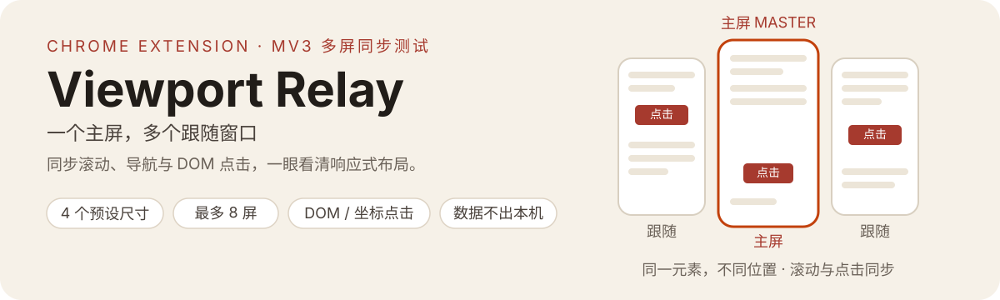
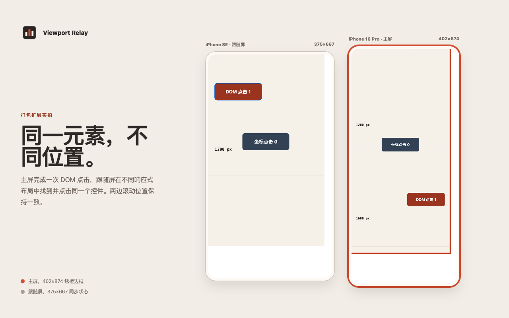

<p align="right"><a href="README.en.md">English</a></p>

<p align="center">
  
</p>

<p align="center">
  <a href="https://xiaosang.cc/multi-screen-view/">▶ 在线体验启动页</a>
  ·
  <a href="https://github.com/holynova/multi-screen-view">GitHub 仓库</a>
</p>

Viewport Relay 是一款 Chrome 扩展（Manifest V3）：输入一个网址，选好屏幕组合，扩展把页面分别打开在多个独立 Chrome 窗口里并排好；以其中一个窗口为主屏，其余窗口自动跟随——滚动、导航、点击同步进行，一眼看清同一页面在不同移动端尺寸下的响应式布局。纯 JS，零依赖。

## 截图

<p align="center">
  
  
</p>

## 同步什么

- **滚动**：主屏滚动，跟随窗口同步滚动到对应位置。
- **导航**：主屏跳转到新页面，跟随窗口打开同一 URL。
- **点击**：默认按 DOM 元素特征匹配——在不同布局里找到并点击同一个控件；可切换相对坐标模式，适合 Canvas 与可视化页面。
- **会话控制**：聚焦主屏、全部刷新、暂停 / 继续同步、重新排列、关闭全部窗口；主屏关闭后自动切换到下一个窗口。

## 屏幕组合

4 个预设尺寸，一次最多启用 8 个窗口：

| 尺寸 | 分辨率 | 说明 |
|---|---|---|
| iPhone SE | 375 × 667 | 小屏基线 |
| iPhone XR | 414 × 896 | 宽屏旧机型 |
| iPhone 16 Pro | 402 × 874 | 默认主屏 |
| iPhone 16 Pro Max | 440 × 956 | 大屏基线 |

也可以添加自定义尺寸（宽 240–1000 px、高 320–2000 px，最多 8 个），保存在当前浏览器，下次打开仍可使用。

## 隐私

- 同步数据（URL、窗口与显示器尺寸、滚动位置、点击位置、被点击元素的少量属性与文本特征）只在当前 Chrome 会话内传递，不上传给开发者、不出售、不用于广告。
- 首次启动会话前，启动页会展示数据处理说明，需主动勾选同意。
- 扩展不读取、不同步表单输入内容；无账号系统、无远程代码。

## 安装

Chrome Web Store 尚未上架（上架文案与素材已备好，见 `store-listing/` 与 `store-assets/`）。目前请加载已解压的扩展程序：

1. 下载或克隆本仓库。
2. 打开 `chrome://extensions`，开启右上角「开发者模式」。
3. 点「加载已解压的扩展程序」，选择仓库目录。
4. 点工具栏的 Viewport Relay 图标打开启动页。

也可以用 `npm run package:extension` 打包出 `dist/viewport-relay-1.0.0.zip` 再安装。

## 使用

1. 打开启动页（扩展图标，或[在线启动页](https://xiaosang.cc/multi-screen-view/)）。
2. 输入要测试的网址，选择点击同步模式（DOM 元素匹配 / 相对坐标）。
3. 勾选数据处理说明，选择屏幕组合并指定主屏。
4. 点「启动多屏」，在主屏里滚动、点击或跳转，跟随窗口会自动同步。

注意：启动页本身是静态页面，真正的多屏同步需要扩展已安装；未安装扩展时提交表单会跳转到本仓库。

## 本地运行与测试

启动页是纯静态页面：

```bash
npm run serve   # python3 -m http.server 8765，打开 http://127.0.0.1:8765
```

测试（语法检查 + Node 测试 + 商店素材校验）：

```bash
npm test
```

## 技术

- Manifest V3：Service Worker（`background.js`）管理会话与窗口排列，内容脚本（`targeting.js` + `content.js`）上报滚动与点击。
- 点击同步两种模式：DOM 元素特征匹配（默认）与相对坐标。
- 窗口布局按当前显示器的工作区域计算（`layout.js`），自定义尺寸校验在 `devices.js`。
- 零依赖，纯 JS + HTML + CSS。

```
index.html          启动页：测试地址 / 点击模式 / 屏幕组合 / 运行状态
launcher.js         启动页逻辑：预设尺寸、自定义尺寸、会话控制
background.js       Service Worker：会话、窗口排列、滚动/点击/导航同步
content.js          内容脚本：上报滚动与点击、执行跟随动作
targeting.js        点击目标描述：DOM 元素特征提取
devices.js          尺寸校验：预设与自定义尺寸的范围检查
layout.js           窗口布局：按显示器工作区域排列窗口
manifest.json       MV3 清单：storage / system.display / windows 权限
privacy.html        隐私政策
store-assets/       商店截图、推广图与图标源文件
store-listing/      中英文上架文案与提交清单
test/               Node 测试：devices / layout / targeting
```

## 许可

MIT，见 `LICENSE`。
